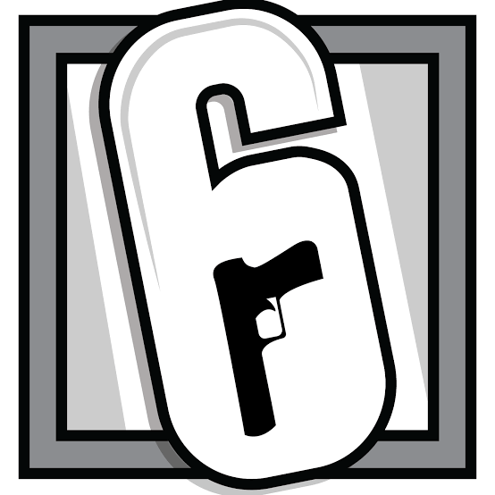
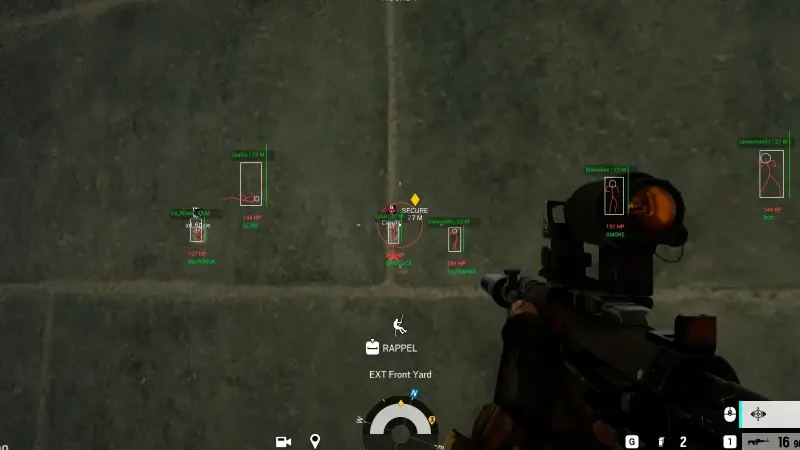

# Rainbow Six Siege Cheats — [R6SiegeCheat.com](https://r6siegecheat.com)

<p align="center">
  <a href="https://r6siegecheat.com">
    
  </a>
</p>

<p align="center">
  <strong>Official repository for the <a href="https://r6siegecheat.com">r6siegecheat.com</a> marketing site</strong> — product guides, compatibility notes, and checkout links for <strong>Rainbow Six Siege cheats</strong> and related utilities on PC.
</p>

<p align="center">
  <a href="https://r6siegecheat.com"><strong>Visit r6siegecheat.com</strong></a>
  &nbsp;·&nbsp;
  <a href="https://zadeyo.com/go/UMAMA?to=%2Fproducts%2Frainbow-six-siege"><strong>Secure checkout (Rainbow Six Siege)</strong></a>
  &nbsp;·&nbsp;
  <a href="https://r6siegecheat.com/products/rainbow-six-siege-cheats/">Compare R6 cheat packages</a>
</p>

---

> **Important — read before use**  
> Third-party tools for Rainbow Six Siege may violate [Ubisoft Terms of Use](https://legal.ubisoft.com/) and can interact with BattlEye anti-cheat. **Account penalties, including permanent bans, are possible.** This repository hosts the **public website source code** (Astro static site). It does **not** distribute game hacks, loaders, or bypass software. Product access, **R6 cheat download**, and setup happen only through the purchaser portal linked from [r6siegecheat.com](https://r6siegecheat.com) after checkout. We do **not** guarantee safety, stealth, or specific outcomes.

---

## Introduction

Shoppers searching for **R6 Siege cheats**, **R6 cheats for PC**, or **Rainbow Six Siege cheats price** information often land on scattered repos that promise “undetected” builds without clear product boundaries. **R6SiegeCheat** documents a single maintained storefront: combat tooling (**R6 aimbot**-style aim & recoil modules, **R6 ESP**, map awareness, and related Elite features), plus separate utilities (HWID, appeals, local Operator Skins preview).

Use this README as a map to **verified pages on the live site**. For the full feature matrix, screenshots, and current maintenance status, always prefer [https://r6siegecheat.com](https://r6siegecheat.com).

<p align="center">
  <a href="https://r6siegecheat.com">
    
  </a>
  <br />
  <em>Product imagery as published on the site — not a guarantee of in-game behavior.</em>
</p>

---

## Table of contents

- [Products & R6 cheat packages](#products--r6-cheat-packages)
- [Documented features (Elite)](#documented-features-elite)
- [Rainbow Six Siege cheats price](#rainbow-six-siege-cheats-price)
- [Compare before you buy R6 cheats](#compare-before-you-buy-r6-cheats)
- [R6 cheat compatibility & download](#r6-cheat-compatibility--download)
- [Guides & long-tail topics](#guides--long-tail-topics)
- [FAQ (summary)](#faq-summary)
- [Support](#support)
- [About this repository](#about-this-repository)
- [GitHub discoverability](#github-discoverability)

---

## Products & R6 cheat packages

| Product | Purpose (as documented on site) | Detail page |
| --- | --- | --- |
| **Rainbow Six Siege Elite** | Primary **R6 Siege cheats** suite: ESP, aim & recoil tooling, utility automation, Operator Skins module, priority patch queue | [Elite cheats](https://r6siegecheat.com/products/rainbow-six-siege-cheats/elite/) |
| **HWID Spoofer** | Hardware profile tooling for flagged PCs (not a combat cheat) | [HWID Spoofer](https://r6siegecheat.com/products/rainbow-six-siege-cheats/hwid-spoofer/) |
| **Operator Skins** | Local cosmetic preview utility | [Operator Skins](https://r6siegecheat.com/products/rainbow-six-siege-cheats/unlock-all/) |
| **UGC** | Structured account appeal / recovery workspace | [UGC](https://r6siegecheat.com/products/rainbow-six-siege-cheats/ugc/) |

**Hub:** [All Rainbow Six Siege products & utilities](https://r6siegecheat.com/products/rainbow-six-siege-cheats/)

**Primary checkout (Elite / default R6 product):**  
[https://zadeyo.com/go/UMAMA?to=%2Fproducts%2Frainbow-six-siege](https://zadeyo.com/go/UMAMA?to=%2Fproducts%2Frainbow-six-siege)

HWID checkout uses a dedicated product URL on the same provider — see the [HWID product page](https://r6siegecheat.com/products/rainbow-six-siege-cheats/hwid-spoofer/) for the live **Buy now** link.

---

## Documented features (Elite)

The site groups **Rainbow Six Siege cheats** capabilities into modules. Below is a concise index; authoritative wording and limits are on each product page.

| Module | What the site describes |
| --- | --- |
| **Aim & Recoil** | Recoil chains, smart trigger timing, delay sliders, operator presets |
| **R6 ESP** | Operator boxes, HP/cooldown readouts, gadget/camera locators, missing-enemy alerts |
| **Map / minimap** | Rotate timers, last-seen hints, objective/flank reminders |
| **Recoil control** | Target selector, utility activator, per-operator chains in portal |
| **Utility suite** | Operator Skins preview, trigger assist, gadget timing, stream-proof modes |
| **Wallhack / vision** | Documented as part of the ESP suite (see [wallhack guide](https://r6siegecheat.com/blog/rainbow-six-siege-wallhack-options/)) |
| **R6 aimbot** | Discussed in context of aim-assist & recoil settings — [R6 aimbot article](https://r6siegecheat.com/blog/r6-aimbot-features-settings/) |
| **Cloud config & updates** | Portal-backed presets; loader updates tied to Siege / BattlEye patch days |

**Feature overview on homepage:** [https://r6siegecheat.com/#features](https://r6siegecheat.com/#features)

---

## Rainbow Six Siege cheats price

Published USD plans on **r6siegecheat.com** (confirm on the product panel before purchase):

| Product | Monthly | Lifetime (one-time) |
| --- | ---: | ---: |
| **Rainbow Six Siege Elite** | **$35** | **$150** |
| **HWID Spoofer** | **$35** | **$150** |
| **Operator Skins** | **$35** | **$150** |
| **UGC** | — | **$50** (one-time) |

**Pricing guides on the blog:**

- [Rainbow Six Siege cheats price: plans & value](https://r6siegecheat.com/blog/rainbow-six-siege-cheats-price-plans-value/)
- [Compare features, products & pricing](https://r6siegecheat.com/blog/rainbow-six-siege-cheats-compare-features-pricing/)

---

## Compare before you buy R6 cheats

Commercial search intent around **buy R6 cheats** usually covers four questions: maintenance status, platform fit, which **R6 cheat packages** match your goal, and support paths.

| Question | Where it is answered on the site |
| --- | --- |
| Which product do I need? | [Products hub](https://r6siegecheat.com/products/rainbow-six-siege-cheats/) + [package breakdown](https://r6siegecheat.com/blog/rainbow-six-siege-cheat-packages-included/) |
| Pre-purchase checklist | [Buy R6 Siege cheats — what to check](https://r6siegecheat.com/blog/buy-r6-siege-cheats-before-you-choose/) |
| Elite vs utilities | [Best R6 cheats — features & packages](https://r6siegecheat.com/blog/best-r6-cheats-features-packages/) |
| Patch-day behavior | [R6 cheats after game updates](https://r6siegecheat.com/blog/r6-cheats-after-game-updates-compatibility/) |
| Why-us comparison table | [Homepage — Why us](https://r6siegecheat.com/#why-us) |

---

## R6 cheat compatibility & download

### Compatibility (documented)

| Requirement | Details on site |
| --- | --- |
| **Platform** | **R6 cheats for PC** — Rainbow Six Siege via **Ubisoft Connect** on **Windows 10 / 11** (64-bit) |
| **Not supported** | macOS and Linux |
| **Anti-cheat** | BattlEye — check live status after patches |
| **Delivery** | External loader + portal; **R6 cheat download** available after purchase through the operator portal (not via this GitHub repo) |

**Setup & requirements:**

- [R6 cheat download, compatibility & setup](https://r6siegecheat.com/blog/r6-cheat-download-compatibility-setup/)
- [R6 cheats for PC — Windows requirements](https://r6siegecheat.com/blog/r6-cheats-for-pc-windows-requirements/)
- [Setup guide (homepage)](https://r6siegecheat.com/#setup-guide)

Always read the **live status banner** on [r6siegecheat.com](https://r6siegecheat.com) before launching the game or buying during maintenance.

---

## Guides & long-tail topics

The [blog](https://r6siegecheat.com/blog/) covers buying guides, **R6 ESP**, **R6 wallhack** options, DMA context (informational), unlock-all / Operator Skins, and support workflows — written for shoppers comparing **Rainbow Six Siege cheats** on PC.

| Topic | Article |
| --- | --- |
| **R6 ESP cheats** | [Player ESP & visuals](https://r6siegecheat.com/blog/r6-esp-cheats-player-visuals/) |
| **R6 wallhack** | [Wallhack options](https://r6siegecheat.com/blog/rainbow-six-siege-wallhack-options/) |
| **R6 aimbot settings** | [Aimbot features & settings](https://r6siegecheat.com/blog/r6-aimbot-features-settings/) |
| **Support & purchase info** | [Support, setup & purchase](https://r6siegecheat.com/blog/rainbow-six-siege-cheats-support-setup-purchase/) |

---

## FAQ (summary)

Full accordion FAQ: [https://r6siegecheat.com/faq/](https://r6siegecheat.com/faq/)

| Topic | Summary (see site for full answers) |
| --- | --- |
| Online status | Check homepage banner and Discord `#status` after Siege or BattlEye updates |
| Ban risk | Third-party tools can violate Ubisoft policies; penalties are possible |
| Supported OS | Ubisoft Connect Rainbow Six Siege on Windows 10/11 only |
| License moves | HWID resets / machine changes handled through support channels documented on site |
| Products list | [Products hub](https://r6siegecheat.com/products/rainbow-six-siege-cheats/) |

---

## Support

| Channel | Link |
| --- | --- |
| **Support page** | [https://r6siegecheat.com/support/](https://r6siegecheat.com/support/) |
| **Discord** | [https://discord.com/invite/Vu85F8auQS](https://discord.com/invite/Vu85F8auQS) |
| **Community (homepage)** | [Join Discord section](https://r6siegecheat.com/#discord) |

Include order email, Windows version, and loader error details when opening a ticket (see support page checklist).

---

## About this repository

This project builds the **static marketing website** for [r6siegecheat.com](https://r6siegecheat.com) (Astro + Tailwind). It is intended for developers and contributors working on site content, SEO pages, and checkout redirects — **not** for obtaining cheat software.

### Local development

**Requirements:** Node.js `>=22.12.0` (see `package.json`)

```bash
npm install
npm run dev
```

```bash
npm run build    # production static output in dist/
npm run preview  # serve dist/
```

### Legal pages

- [Privacy Policy](https://r6siegecheat.com/privacy/)
- [Terms & Conditions](https://r6siegecheat.com/terms/)
- [About](https://r6siegecheat.com/about/)

---

## GitHub discoverability

Suggested **repository description** (GitHub → Settings → General):

> Official source for r6siegecheat.com — Rainbow Six Siege cheats product guides, R6 ESP/aimbot docs, pricing, compatibility, and secure checkout links for PC.

Suggested **Topics** (add only what accurately describes this repo):

`rainbow-six-siege` · `rainbow-six` · `r6siege` · `ubisoft-connect` · `gaming` · `astro` · `static-site` · `documentation` · `product-comparison` · `esp` · `aimbot` · `wallhack` · `cheats` · `r6-cheats`

> Avoid tagging this repo as a cheat **binary** or bypass project — it is the **website** codebase.

---

## Keyword map (for maintainers)

Natural placement targets used in this README (no ranking claims):

| Primary | Secondary / long-tail |
| --- | --- |
| Rainbow Six Siege cheats | R6 Siege cheats, R6 cheats |
| Buy R6 cheats | Rainbow Six Siege cheats price |
| R6 cheat packages | R6 cheat compatibility |
| R6 aimbot | R6 ESP, R6 wallhack |
| R6 cheats for PC | R6 cheat download |

When editing copy, keep claims aligned with live product pages and blog posts on [r6siegecheat.com](https://r6siegecheat.com).

---

<p align="center">
  <a href="https://r6siegecheat.com"><strong>→ r6siegecheat.com — Rainbow Six Siege Cheats & Features</strong></a>
</p>

<p align="center">
  <sub>© R6SiegeCheat · This README is informational. Cheating in online games may violate publisher rules and local laws. Use at your own risk.</sub>
</p>
